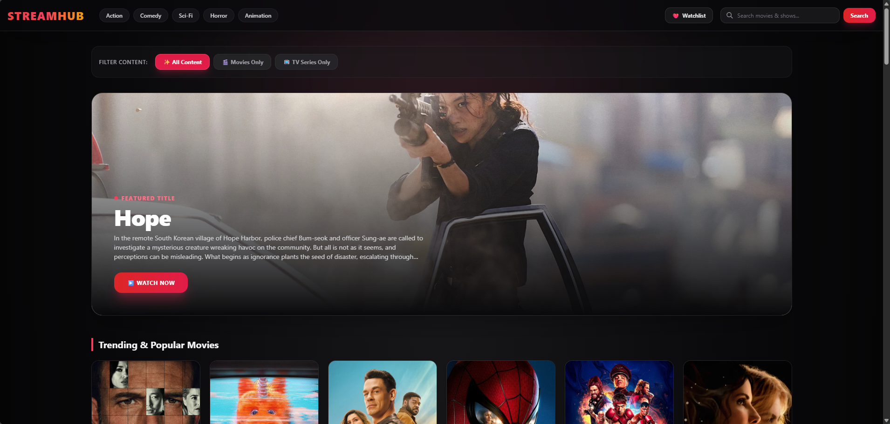
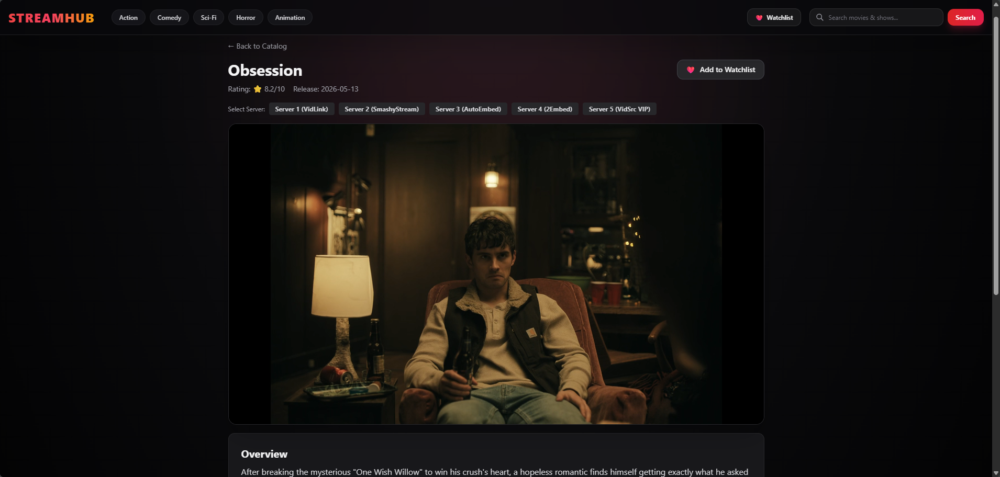
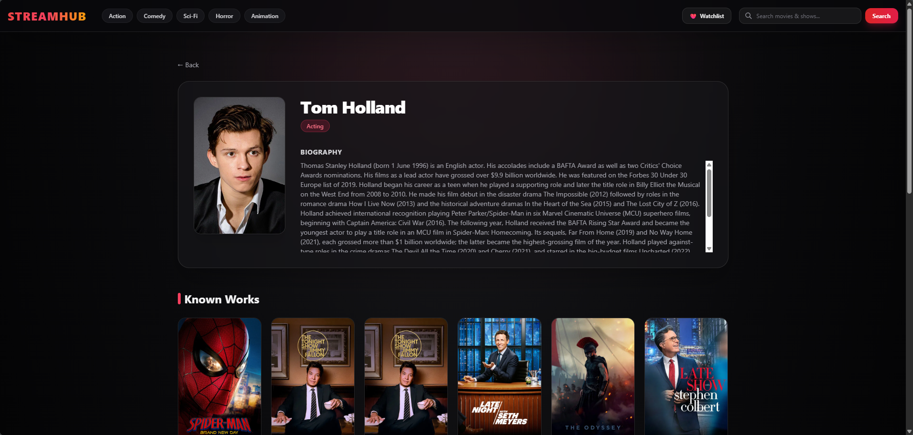
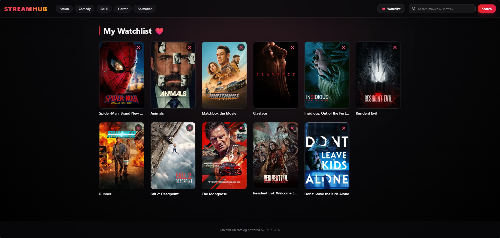

# StreamHub 🎬🍿

StreamHub is a modern, responsive web application for exploring trending movies, popular TV series, genre-based catalogs, and detailed actor profiles. Built with a Django backend and styled using Tailwind CSS, it seamlessly integrates with the TMDB (The Movie Database) API to deliver continuous title browsing, dynamic multi-server streaming embed options, and a client-side watchlist.

---

## 🌟 Key Features

- **Dynamic Content Filtering:** Switch seamlessly between **All Content**, **Movies Only**, and **TV Series Only** directly from the home dashboard.
- **Genre & Search Browsing:** Filter content by genres (Action, Comedy, Sci-Fi, Horror, Animation, etc.) or search for specific titles using real-time query handling.
- **Hero Title Showcase:** Highlights top trending titles with high-resolution backdrops and direct watch access.
- **Continuous / Infinite Scrolling:** Dynamically loads additional title pages as the user scrolls without requiring manual page reloads.
- **Interactive Watch Page & Multi-Server Streaming:**
  - Multi-server embed selection for reliability.
  - Interactive Season & Episode selector for TV series.
  - Complete media overview and rating stats.
- **Actor & Crew Profiles:** Detailed actor biography, department information, and a grid of top-rated known works.
- **Local Watchlist:** Save favorite movies and TV shows directly to your browser's local storage for easy access later.
- **Modern Glassmorphic UI:** Clean, dark-mode design with smooth animations, ambient light accents, and responsive layout built with Tailwind CSS.

---

## 🖼️ Screenshots

### 📍 Home Dashboard & Content Filter


### 📍 Title Detail & Streaming Player


### 📍 Actor Profile & Filmography


### 📍 Personal Watchlist


---

## 🛠️ Tech Stack

- **Backend:** Python, Django
- **Frontend:** HTML5, Tailwind CSS, JavaScript (ES6)
- **External API:** TMDB (The Movie Database) API
- **Database:** SQLite3 (Django Default)
- **State Management:** Client-Side Browser `localStorage` (Watchlist)

---

## 🚀 Step-by-Step Setup Instructions

Follow these step-by-step instructions to get StreamHub running on your local development environment.

### 1. Prerequisites
Ensure you have the following installed on your machine:
- **Python 3.10+** (Verify by running `python --version` or `python3 --version` in terminal)
- **Git** (Verify by running `git --version`)
- **pip** (Python package installer)

---

### 2. Clone the Repository
Open your terminal or command prompt and clone the project:

```bash
git clone [https://github.com/MrNoBody0402/StreamHUB.git](https://github.com/MrNoBody0402/StreamHUB.git)
cd StreamHUB
```

---

### 3. Create & Activate a Virtual Environment
Isolate project dependencies using a virtual environment.

On Windows:
```bash
python -m venv venv
venv\Scripts\activate
```

On macOS / Linux:
```
python3 -m venv venv
source venv/bin/activate
```

---

### 4. Install Dependencies
Install all required Python packages:

```bash
pip install django requests
```
(Or if using a requirements file:)
```bash
pip install -r requirements.txt
```

---

### 5. Run Database Migrations
Set up Django's internal database tables:
```bash
python manage.py migrate
```

### 6. Start the Development Server
Launch the application locally:

```bash
python manage.py runserver
```

Open your web browser and visit:
[http://127.0.0.1:8000/](http://127.0.0.1:8000/)


### 📁 Project Structure
```
StreamHUB/
│
├── catalog/                          # Core Application
│   ├── templates/                    # HTML Templates
│   │   └── catalog/
│   │       ├── actor.html            # Actor profile & filmography view
│   │       ├── base.html             # Main layout with header & navigation
│   │       ├── home.html             # Dashboard with filters & grid layout
│   │       ├── watch.html            # Embed video player & episode loader
│   │       └── watchlist.html        # Client-side saved titles page
│   │
│   ├── admin.py                      # Admin configuration
│   ├── apps.py                       # App configuration
│   ├── models.py                     # Data models
│   ├── services.py                   # TMDB API functions
│   ├── tests.py                      # Tests
│   ├── urls.py                       # Application URL routing
│   └── views.py                      # View logic & context rendering
│
├── screenshots/                      # Preview images for documentation
│   ├── actor.png.png
│   ├── home.png.png
│   ├── watch.png.png
│   └── watchlist.png.png
│
├── streamhub/                        # Django Project Settings
│   ├── settings.py                   # App configuration & settings
│   ├── urls.py                       # Root route management
│   └── wsgi.py
│
├── db.sqlite3                        # Database file
├── manage.py                         # CLI tool for Django
└── README.md                         # Documentation
```
